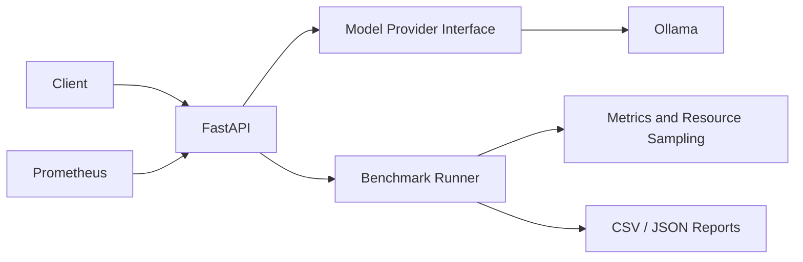

# LLM Serving & Performance Benchmark Platform


A lightweight local platform for serving LLMs through Ollama, benchmarking generation performance, and exposing API metrics.

## Features

- FastAPI endpoints for health, model discovery, generation, and benchmark runs
- Ollama provider abstraction
- Measurements for end-to-end latency and Ollama-reported token counts/durations
- Throughput calculated from Ollama generation statistics
- CSV and JSON benchmark exports
- Prometheus instrumentation and system CPU/RAM snapshots
- Locust load-test scenario
- Docker Compose stack: API, Ollama, Prometheus
- Automated tests that do not require a running model

## Architecture



## Requirements

- Python 3.11+
- Docker and Docker Compose (for containerized setup)
- 8 GB RAM is a practical starting point for small quantized models; actual requirements depend on model size and context length.
- CPU-only execution is supported. GPU acceleration is optional and not assumed.

## Local installation

```bash
python -m venv .venv
# Windows: .venv\Scripts\activate
# macOS/Linux: source .venv/bin/activate
pip install -r requirements.txt
cp .env.example .env
```

Start Ollama separately, then pull a small model:

```bash
ollama pull llama3.2:1b
```

Start the API:

```bash
uvicorn app.main:app --reload
```

Swagger UI: http://localhost:8000/docs

## Docker Compose

```bash
docker compose up --build -d
docker compose exec ollama ollama pull llama3.2:1b
```

API: http://localhost:8000  
Prometheus: http://localhost:9090

Check Prometheus targets at `/targets`. The API metrics endpoint is `/metrics`.

## API examples

List models:

```bash
curl http://localhost:8000/models
```

Generate:

```bash
curl -X POST http://localhost:8000/generate \
  -H "Content-Type: application/json" \
  -d '{"prompt":"Explain vector databases briefly","model":"llama3.2:1b","max_tokens":100}'
```

Run a benchmark:

```bash
curl -X POST http://localhost:8000/benchmark \
  -H "Content-Type: application/json" \
  -d '{"prompt":"Explain caching","models":["llama3.2:1b"],"repeats":3}'
```

Reports are written to `reports/` in JSON and CSV.

## Load testing

```bash
locust -f locustfile.py --host http://localhost:8000
```

Open the Locust UI at http://localhost:8089 and configure users, spawn rate, and duration. The default task uses a short prompt and small output limit.

## Tests

```bash
pytest -q
```

The default test suite mocks the model provider for benchmark tests and does not download a real LLM.

## Metrics and interpretation

- End-to-end latency is measured by the API process around each generation call.
- Prompt and generated token counts, plus generation duration, are taken from Ollama when present.
- Throughput is generated tokens divided by Ollama's generation duration.
- CPU and RAM are sampled around benchmark calls and are system-level snapshots, not per-model attribution.
- Missing Ollama statistics remain `null`; the application does not invent token counts.
- Current implementation accepts `stream` in the request schema but generation is non-streaming. Streaming/TTFT is a planned extension and is not reported as implemented.

## Limitations

- Benchmark execution is synchronous within the request; long experiments occupy an API worker.
- Benchmark history is in memory and resets when the API restarts.
- Streaming generation and TTFT are not implemented in this initial version.
- Prometheus instrumentation exposes HTTP request metrics; custom model-specific Prometheus counters/histograms are future work.
- CPU/RAM snapshots are host/container-level, not process-isolated attribution.
- Load test metrics are collected by Locust itself.

## Future improvements

- Implement true Ollama streaming and TTFT measurement
- Add persistent experiment storage
- Add custom Prometheus metrics for tokens and model latency
- Add concurrency controls and background benchmark execution
- Add vLLM provider implementation
- Add richer comparison charts and confidence intervals

## License

MIT
