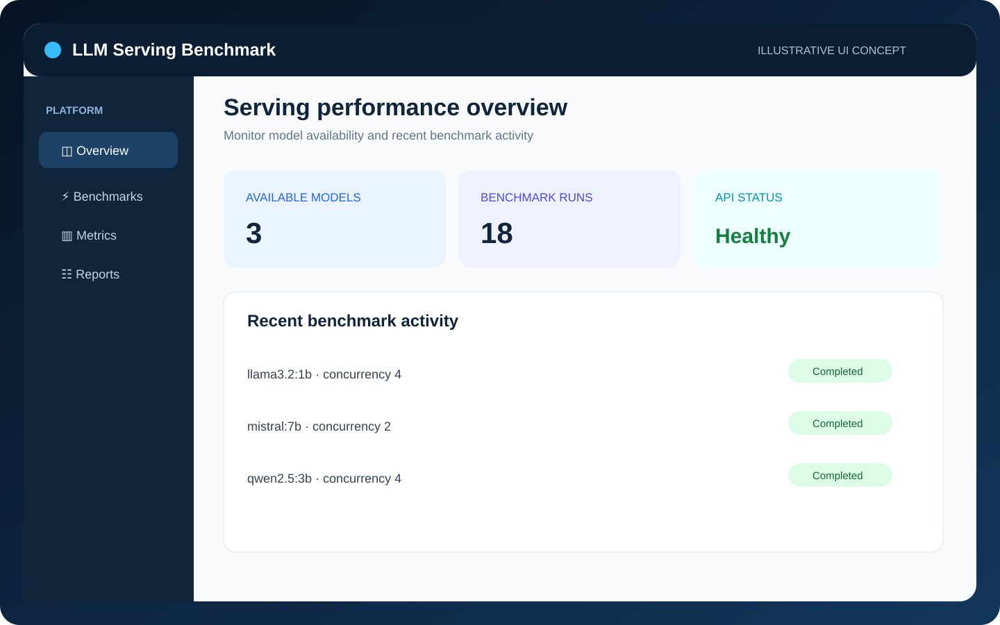
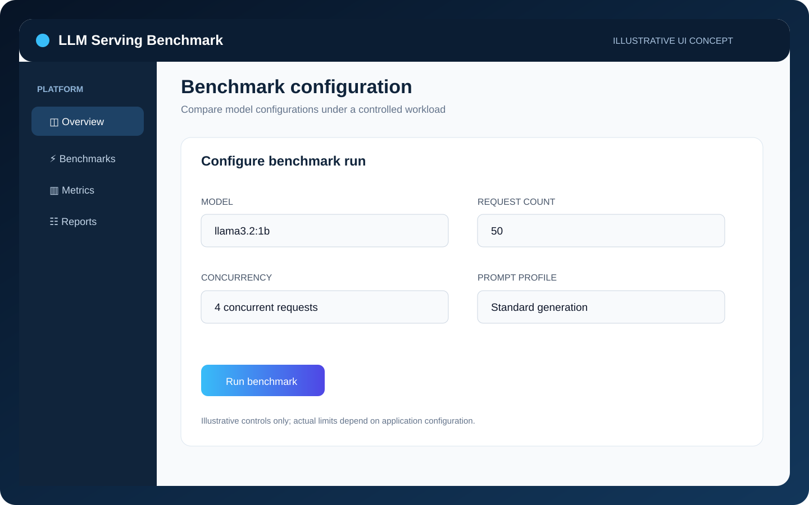
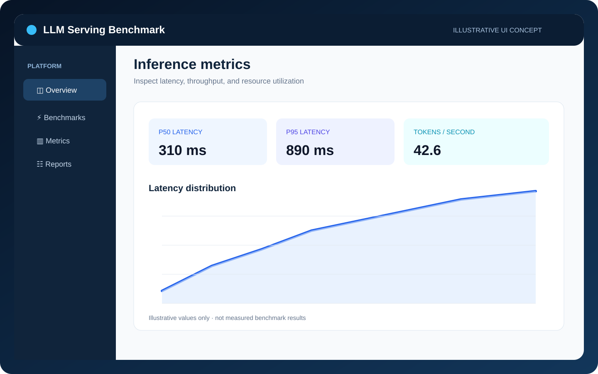
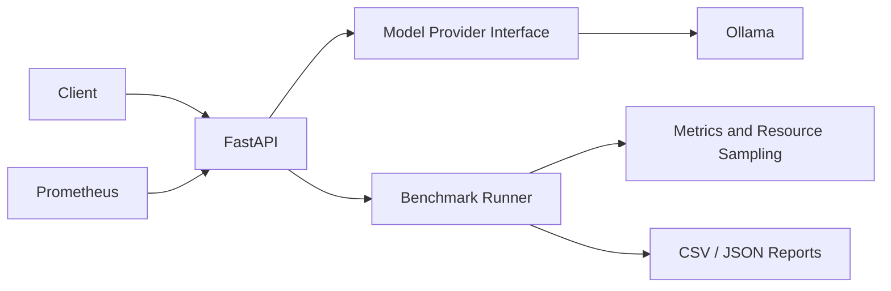

# LLM Serving & Performance Benchmark Platform


A local platform for **serving Large Language Models (LLMs), benchmarking inference performance, and monitoring API-level behavior** using Ollama, FastAPI, Prometheus, and Locust.

The project brings together a model-provider interface, synchronous benchmark execution, latency and throughput measurements, system resource snapshots, and CSV/JSON reporting. It is designed as an engineering environment for exploring LLM serving behavior on local hardware.

## Dashboard Preview

These illustrative UI mockups demonstrate the platform's serving, benchmark-configuration, and performance-inspection workflows. Displayed metrics are placeholders, not measured results from a benchmark run.

### Serving overview



### Benchmark configuration



### Inference metrics



## Key Capabilities

- **LLM serving API:** FastAPI endpoints for health checks, model discovery, text generation, and benchmark execution.
- **Ollama integration:** A provider abstraction that connects the application to locally served models.
- **Performance measurement:** End-to-end request latency and Ollama-reported token counts and generation duration.
- **Throughput calculation:** Generated tokens per second based on Ollama generation statistics.
- **Benchmark reporting:** Export benchmark results to CSV and JSON.
- **Observability:** Prometheus instrumentation and CPU/RAM snapshots around benchmark calls.
- **Load testing:** A Locust scenario for exercising the generation API under configurable load.
- **Containerized environment:** Docker Compose services for the API, Ollama, and Prometheus.
- **Automated tests:** A test suite that mocks the model provider and does not require a running LLM.

## Architecture

The API communicates with a model-provider interface backed by Ollama. Benchmark execution coordinates generation calls, collects available performance and resource measurements, and writes structured reports. Prometheus scrapes the API metrics endpoint.



## Technology Stack

| Area | Technologies |
|---|---|
| Language | Python 3.11+ |
| API | FastAPI |
| Model runtime | Ollama |
| Metrics and monitoring | Prometheus instrumentation |
| Load testing | Locust |
| Reporting | CSV, JSON |
| Containerization | Docker, Docker Compose |
| Testing | Pytest |

## Requirements

- Python 3.11+
- Ollama for local model serving
- Docker and Docker Compose for containerized setup (optional)
- 8 GB RAM is a practical starting point for small quantized models; actual requirements depend on model size and context length.
- CPU-only execution is supported. GPU acceleration is optional and is not assumed.

## Local Setup

### 1. Create a virtual environment

```bash
python -m venv .venv
```

Activate it:

**Windows**
```powershell
.venv\\Scripts\\activate
```

**macOS / Linux**
```bash
source .venv/bin/activate
```

### 2. Install dependencies and configure the environment

```bash
pip install -r requirements.txt
cp .env.example .env
# Set API_KEY in .env to a long, random secret before starting the API
```

On Windows PowerShell, create the environment file with:

```powershell
Copy-Item .env.example .env
```

### 3. Start Ollama and pull a model

Install and start Ollama separately, then download a small model:

```bash
ollama pull llama3.2:1b
```

The model must be available to the Ollama service before running generation or benchmark requests.

### 4. Start the API

```bash
uvicorn app.main:app --reload
```

- API base URL: http://localhost:8000
- Interactive Swagger documentation: http://localhost:8000/docs

## Docker Compose

Build and start the API, Ollama, and Prometheus services:

```bash
docker compose up --build -d
```

Pull a model inside the Ollama service:

```bash
docker compose exec ollama ollama pull llama3.2:1b
```

Available endpoints:

| Service | URL |
|---|---|
| FastAPI | http://localhost:8000 |
| API documentation | http://localhost:8000/docs |
| Prometheus | http://localhost:9090 |
| API metrics | http://localhost:8000/metrics |
| Prometheus targets | http://localhost:9090/targets |

Check the Prometheus targets page to verify that the API scrape target is available.

## API Usage

### List available models

```bash
curl http://localhost:8000/models -H 'X-API-Key: YOUR_API_KEY'
```

### Generate text

```bash
curl -X POST http://localhost:8000/generate \\
  -H "Content-Type: application/json" \\
  -d '{"prompt":"Explain vector databases briefly","model":"llama3.2:1b","max_tokens":100}'
```

### Run a benchmark

```bash
curl -X POST http://localhost:8000/benchmark \\
  -H "Content-Type: application/json" \\
  -d '{"prompt":"Explain caching","models":["llama3.2:1b"],"repeats":3}'
```

Benchmark reports are written to the `reports/` directory in CSV and JSON formats. Operational endpoints (`/models`, `/generate`, `/benchmark`, and `/benchmark/results`) require the `X-API-Key` header. `/health` and `/metrics` remain public. Benchmark requests accept up to five models and ten repeats per model. Docker Compose requires `API_KEY` in `.env`.

## Performance Metrics and Interpretation

The platform collects the following measurements where the underlying runtime provides the required statistics:

| Measurement | Source / Calculation | Interpretation |
|---|---|---|
| End-to-end latency | Measured by the API process around each generation call | Request-level duration observed by the application |
| Prompt token count | Ollama generation statistics | Runtime-reported metadata; may be unavailable |
| Generated token count | Ollama generation statistics | Runtime-reported metadata; may be unavailable |
| Generation duration | Ollama generation statistics | Runtime-reported generation duration |
| Throughput | Generated tokens divided by Ollama generation duration | Runtime-based generation throughput |
| CPU and RAM | System-level snapshots around benchmark calls | Host/container observations, not per-model attribution |
| HTTP request metrics | Prometheus instrumentation | API-level request observability |

Missing Ollama statistics remain `null`; the application does not fabricate token counts or durations.

**Measurement scope matters:** API end-to-end latency and Ollama generation duration represent different measurement boundaries. CPU and RAM readings are system-level snapshots and should not be interpreted as isolated resource consumption for an individual model.

The request schema accepts a `stream` field, but generation is currently non-streaming. Time to First Token (TTFT) is not implemented or reported.

## Load Testing with Locust

Run the included Locust scenario against the API:

```bash
API_KEY=YOUR_API_KEY locust -f locustfile.py --host http://localhost:8000
```

Open the Locust web interface at:

http://localhost:8089

Configure the number of users, spawn rate, and test duration in the UI. The default task uses a short prompt and a small output limit.

Locust collects its own load-test statistics. These measurements complement the application's benchmark reports and should be interpreted separately.

## Testing

Run the automated test suite:

```bash
pytest -q
```

The default tests mock the model provider for benchmark-related scenarios. They do not require Ollama to be running and do not download a real LLM.

## Current Limitations

- Benchmark execution is synchronous within the API request; long-running experiments occupy an API worker.
- Benchmark history is stored in memory and is reset when the API restarts.
- Generation is non-streaming; TTFT measurement is not implemented.
- Prometheus instrumentation currently exposes HTTP request metrics. Custom model-specific token and latency counters/histograms are future work.
- CPU/RAM measurements are host/container-level snapshots, not process-isolated or per-model attribution.
- Load-test statistics are collected by Locust itself.
- Results depend on the selected model, hardware, runtime configuration, prompt, and workload; measurements should be compared under controlled conditions.

## Future Improvements

- Implement true Ollama streaming and TTFT measurement.
- Add persistent experiment storage and benchmark history.
- Introduce custom Prometheus metrics for generated tokens, throughput, and model latency.
- Add concurrency controls and background benchmark execution.
- Implement an additional provider for vLLM.
- Add richer model-comparison charts and confidence intervals.

## License

MIT
